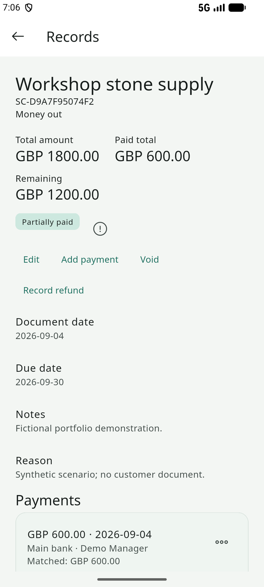
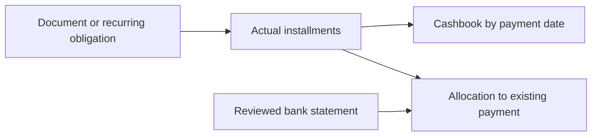
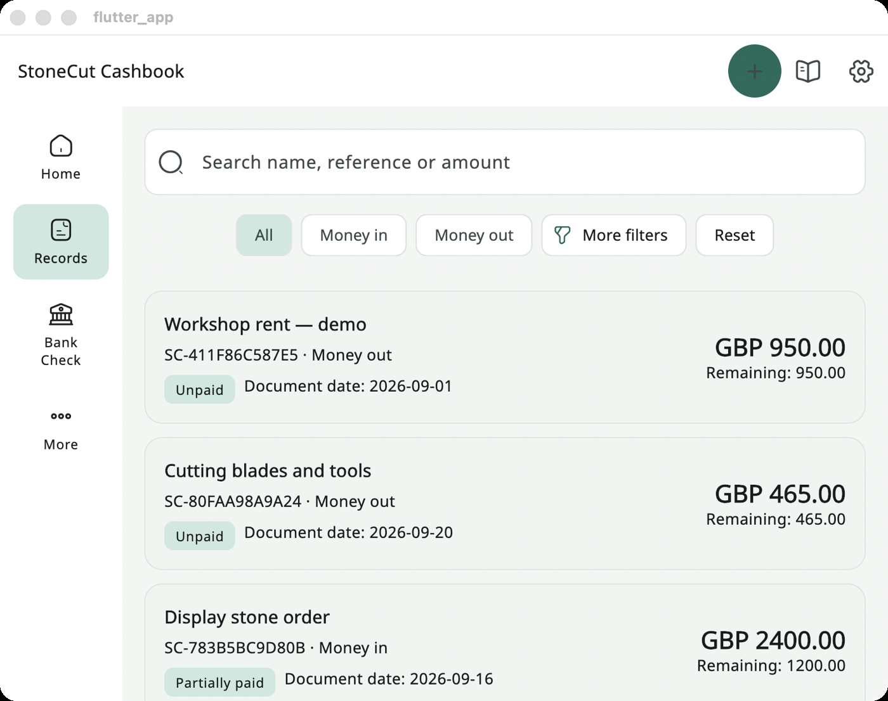
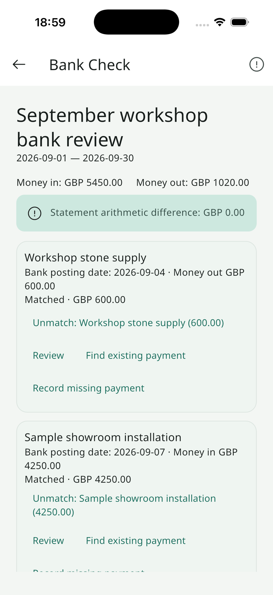
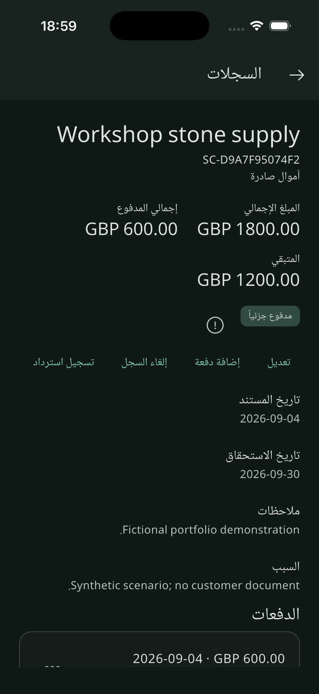
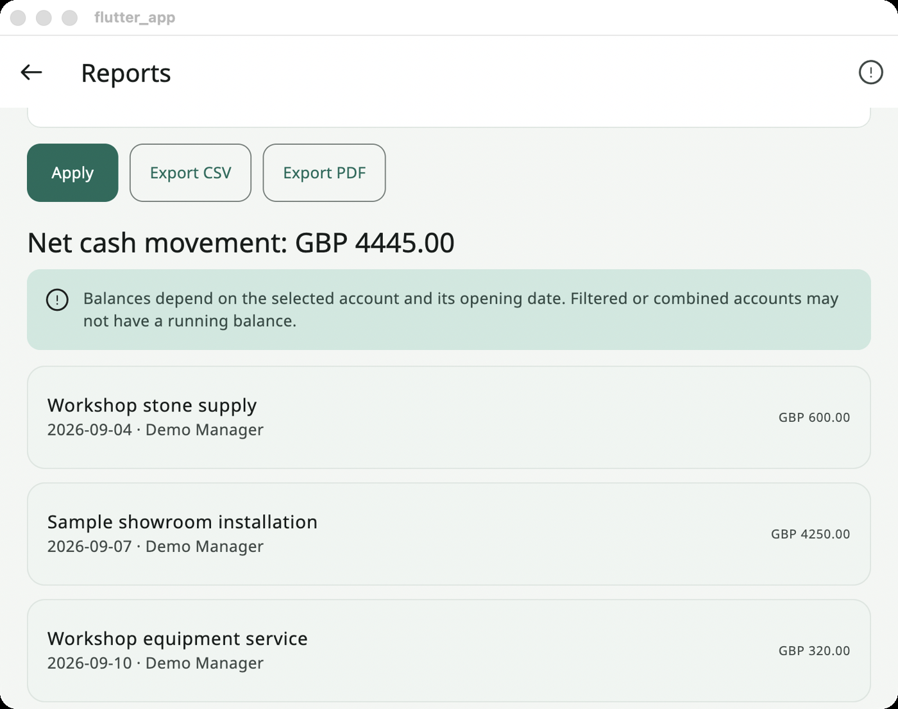

# StoneCut Cashbook

Development-stage cashbook software that keeps documents, installments and reviewed bank evidence distinct.

This is a documentation and visual showcase. The application source code is not included. Technical descriptions and earlier test results come from the prepared project documentation; those application tests were not repeated for this export.

**Portfolio:** [English](https://ideabat.com/portfolio/stonecut-cashbook/) · [Türkçe](https://ideabat.com/tr/portfolio/stonecut-cashbook/) · [العربية](https://ideabat.com/ar/portfolio/stonecut-cashbook/)

**Case study:** [English](https://ideabat.com/case-study/stonecut-cashbook/) · [Türkçe](https://ideabat.com/tr/case-study/stonecut-cashbook/) · [العربية](https://ideabat.com/ar/case-study/stonecut-cashbook/)

## Ragıp Mullamusa’s contribution

I developed StoneCut Cashbook as a client project through Ideabat, covering the Flutter interface, PHP API, MySQL model, financial workflow rules, English/Arabic presentation and verification. It is distinct from Stone Cut’s fabrication workflow platform. The intended release targets are Windows and mobile; no store publication or Windows runtime verification is asserted.

## At a glance

| Concern | Implementation |
|---|---|
| Users | Managers and staff; manager-only user administration |
| Client | Flutter/Dart, ChangeNotifier and feature-oriented screens |
| Backend | Native PHP/PDO API with MySQL |
| Money | GBP integer minor units, transmitted as strings |
| Languages | English LTR and Arabic RTL; light/dark preferences |
| Availability | In development; not published on stores |

## A bank match does not create cash

This conceptual diagram separates obligation, cash movement and supporting evidence. A recurring rule creates a due amount rather than silently posting a payment. A statement allocation consumes available matching capacity against an existing payment rather than duplicating it. Corrections can therefore explain their impact on cash and reconciliation separately.

Transaction boundaries, row locks, version checks and idempotency are documented backend mechanisms. The client waits for backend acknowledgement for financial work; bundled offline-readable help does not imply offline financial synchronization.

A document can exist before any money is paid. A bank posting can appear after a payment. Recurring rent can become due without being settled. StoneCut Cashbook implements these as related but separate states, so the interface can explain what is owed, what moved and what has been compared with bank evidence.

This is an implementation case study of a client project developed by Ideabat. It is in development for Windows and mobile and is not published on stores. No customer interview, baseline measurement or quantified business result is asserted.

## Users and objectives

Managers and staff can record documents, add installments, review statements and open reports. Managers alone administer user accounts. The implementation objective is a connected operational workflow with explicit payment decisions and visible review steps, available in English and Arabic.

## From record to cash movement

In the fictional showcase, a workshop supply document totals GBP 1,800. One GBP 600 installment leaves GBP 1,200 remaining. The settlement calculation derives settlement from active payments, while the cashbook report includes the GBP 600 by transaction date. The document total does not enter cash totals merely because the document exists.

## From statement to reconciliation

Statement intake stages rows for review. Arithmetic and overlap checks precede confirmation. Matching then allocates a positive amount to an existing payment and checks account, direction and unused capacity. A matched bank row does not become a second payment. The sample September statement includes both allocated and outstanding comparison work.

## Architecture and constraints

The Flutter client uses a shared API client, ChangeNotifier state and feature-oriented screens. The PHP router authenticates requests and delegates to domain services backed by MySQL. Records, payments, statement lines and reconciliation links have separate tables. Mutations use transactions, idempotency keys and version checks. Allocation writes lock relevant rows, while reports use snapshot reads.

Money is GBP only and crosses JSON boundaries as integer minor-unit strings. Business dates remain date-only values; timestamp display uses the company timezone. Recurring generation produces obligations without posting payments. Audited direction correction previews payment and matching impact, requires confirmation when applicable, and preserves payment identity while removing affected allocations.

## Interface decisions

The same client supports English/LTR and Arabic/RTL, light/dark preferences and adaptive side-rail/bottom navigation. Bundled searchable help is available without authentication. Financial work still depends on backend acknowledgement; no offline financial synchronization is claimed.

## Integration boundaries and verification

Documents are stored privately and served through authenticated routes. Optional extraction returns candidates for human review; it never automatically records payment or confirms a match. Outbound extraction was disabled for this verification. Live provider quality and physical-device permissions remain separate checks.

New captures show the locally running app with synthetic data. Backend regression tests exercise domain rules, HTTP authorization, competing writes and disposable backup/restore. Windows execution needs a Windows host; macOS desktop evidence cannot substitute for it. Store publication is future work.

## Observable result

The implemented application connects a document to its installments, reports cash by payment date and compares bank evidence against those payments. These are delivered development-stage capabilities. No time saving, adoption, revenue improvement or accuracy percentage is claimed.

[Discuss a similar operational workflow with Ideabat](https://ideabat.com).

## Screen walkthrough

These real application captures come from the project’s prepared publication material. Demonstration records are synthetic; a screen illustrates the interface, not a production deployment or a permission test.

### 01 — Fictional workshop supply document: GBP 1,800 total, GBP 600 paid and GBP 1,200 remaining. Native android capture.

### 02 — Fictional recurring rent and workshop records with payment statuses and remaining amounts. Native macos capture.

### 03 — Fictional September statement showing arithmetic review and allocations to existing payments. Native ios capture.

### 04 — The fictional installment document in the implemented Arabic right-to-left dark interface. Native ios capture.

### 05 — Scrolled cashbook report with persisted synthetic payments and their transaction dates. Native macos capture.

## Evidence and availability

Implementation and historical validation descriptions above are supported by the project’s prepared documentation. The application tests were not rerun for this documentation export. The screenshots demonstrate the captured version, not current service availability, customer adoption or measured commercial outcomes.

## Ownership and technical review

This repository contains documentation and approved visual material, not an application source release. Presentation through Ideabat does not transfer a client’s ownership. For employment, collaboration or technical-review inquiries, contact Ragıp Mullamusa through Ideabat. Access to client-owned source requires prior permission from the project owner and compliance with applicable confidentiality requirements. Requests are reviewed individually; source access is not guaranteed. No software license or redistribution permission is granted by this showcase.

## Contact

Ragıp Mullamusa is the founder of [Ideabat](https://ideabat.com/). For relevant engineering, employment or collaboration inquiries, use [the contact page](https://ideabat.com/contact-us/) or [info@ideabat.com](mailto:info@ideabat.com).
